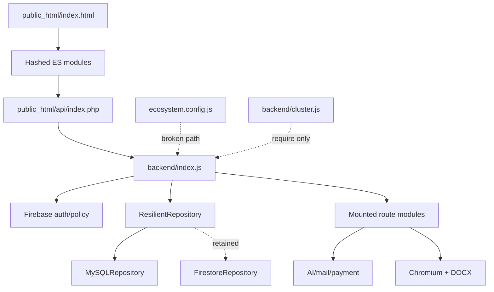

# Architecture Audit

## Current-state assessment

The repository implements a compiled browser SPA, an Apache/PHP gateway, a monolithic Express entry with mounted routers, Firebase identity, MariaDB repositories, provider integrations, and two export engines. The intended stack is viable; production risk comes from conflicting entry points, duplicated control planes, and missing build/test provenance.

## Architectural defects

| Concern | Evidence | Consequence | Issue |
|---|---|---|---|
| Three startup contracts disagree | PM2 root `index.js`; direct guard; cluster require | deploy/cluster failure | OPS-001, OPS-002 |
| Monolithic and modular routes overlap | 142 routes in `index.js`; duplicated mounts/handlers | shadowing and policy drift | ARCH-002, API-002 |
| Privileged mutations have two policy models | platform recent-superadmin vs adminUsers permission OR | authorization bypass | SEC-001 |
| Repository authority is ambiguous | MariaDB plus retained Firestore/sync/fencing | recovery and consistency risk | DB-003 |
| Schema bootstrap is asynchronous to serving | readiness only checks connection | traffic on invalid schema | DB-001 |
| Frontend is artifact-only | no source/build/test inputs | irreproducible repair | ARCH-001 |
| Template policy is client-fragmented | admin/dashboard/editor/export differ | entitlement bypass | BUG-003 |

## Required target state

Preserve the stack while establishing one authoritative contract for each concern:

- one idempotent `startServer()` used by direct and cluster entry points;
- one generated deployment manifest and atomic frontend/backend revision marker;
- one route registry with explicit mount, authentication, authorization, audit, validation, and owner metadata;
- one recent-SUPER_ADMIN guard for every privileged role/MFA/status mutation;
- migrations as the sole schema authority;
- one exhaustive repository method descriptor;
- one frontend source/build pipeline producing deterministic artifacts;
- one server-authoritative template catalog/policy shared by editor, preview, PDF, DOCX and print.
