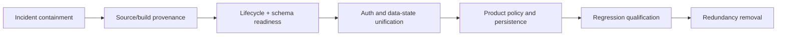

# Architecture Recovery Plan

1. **Contain and freeze.** Execute DATA-001 incident handling and prohibit promotion from the audited revision.
2. **Restore provenance.** Recover the exact frontend source, manifest, lockfile and build configuration; generate artifacts in CI; fail on a dirty or mismatched revision.
3. **Stabilize lifecycle.** Correct PM2, export `startServer()`, await bootstrap, and gate readiness on current schema.
4. **Unify control planes.** Inventory all route aliases and move privileged role/MFA/status operations behind one recent-SUPER_ADMIN policy and service.
5. **Make schema authority explicit.** Declare migrations canonical; restore session invariants on failure; remove retired authorities only after parity.
6. **Centralize product policy.** Serve a signed/versioned template catalog with disabled/free/pro state and enforce it server-side for every output.
7. **Rebuild verification.** Add nonzero unit, integration, security, export, browser and deployment gates.
8. **Consolidate safely.** Remove shadow routes and stale assets only after coverage and runtime manifests prove replacement equivalence.

Each transition is reversible through the rollback steps in the individual fix documents; no big-bang rewrite is proposed.
