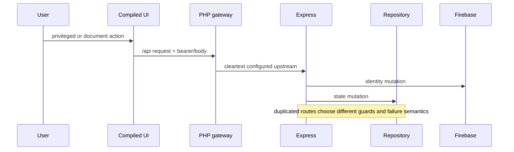

# Module Dependency Map

## Runtime ownership

| Module family | Depends on | Called by | Canonical owner | Risks |
|---|---|---|---|---|
| `backend/index.js` | Express, security, repository, providers, routers | direct Node entry | runtime bootstrap | oversized composition root |
| `backend/cluster.js` | `index.js` | optional supervisor | process lifecycle | does not start listener |
| `backend/routes/platform.js` | auth, DB services, payment state | `/api/platform` | operations/platform | duplicate mount and privileged API overlap |
| `backend/routes/adminUsers.js` | Firebase, repository, policy | `/api/admin/users` | user administration | alternate privileged control plane |
| `backend/repositories/*` | MySQL, Firestore remnants | all business routes | persistence | classification/authority drift |
| `backend/database/*` | mysql2, migrations | bootstrap/admin | schema/data lifecycle | readiness and session invariant defects |
| `backend/security/*` | Firebase claims, role policies | middleware/routes | authorization | sound primitives inconsistently applied |
| `public_html/assets/platform-*.js` | API client and lazy chunks | compiled UI | frontend API facade | cover import contract mismatch |
| `templateCatalog/themePresets` | 51 template IDs | landing/editor/renderer | template metadata | target incomplete |
| `TemplateRenderer/Cv*` | resume data | editor/preview/export HTML | rendering | canonical path ambiguity |
| `Checkout-*.js` | Stripe/PayPal SDKs | checkout route/chunk preload | payment UI | eager third-party load requires review |

## High-risk dependency chain

## Consolidation boundary

Do not merge modules merely because names overlap. First generate a route registry, capture contract tests, select the active owner, and route aliases through the same service. Retired Firestore/sync code can be removed only after runtime reference, migration, backup/restore, and rollback evidence.
