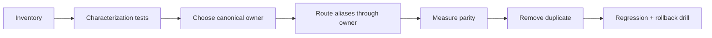

# Safe Consolidation Plan

## Order

1. Source/build provenance and test gate.
2. Route registry and privileged service.
3. Startup/readiness lifecycle.
4. Schema authority and repository classifier.
5. Template catalog/policy.
6. Cover API facade.
7. Retired routes/data-plane modules.
8. Stale compiled assets.

Every removal needs reference search, runtime trace, contract tests, migration/data assessment and an immutable rollback artifact.
