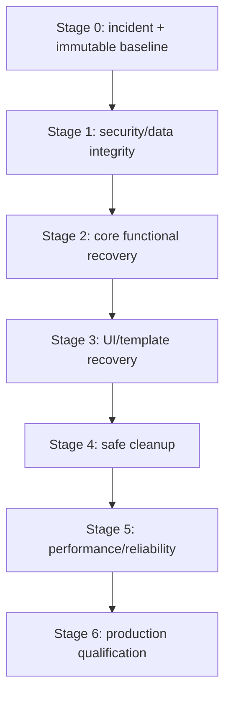

# Master Recovery Plan

| Stage | Issues | Exit criteria |
|---|---|---|
| 0 Baseline | DATA-001, OPS-003, ARCH-001, OPS-004 | incident open/contained; source/artifact provenance and runnable tests |
| 1 Security/data | SEC-001–007, DB-001–003, API-001 | authorization/reset/export/proxy/schema gates pass |
| 2 Functional | BUG-001–004, OPS-001/002, API-002 | startup and core save/admin/webhook journeys pass |
| 3 UI/templates | EXPORT-001/002, UIUX-001–004, BUG-003 | 104-row matrix and five-viewport accessibility pass |
| 4 Cleanup | ARCH-002/003, CLEAN-001, DB-003 | one authority per route/schema/catalog; manifest-clean assets |
| 5 Reliability | SEC-005, health/performance work | load, soak, failure and rollback tests pass |
| 6 Qualification | all | every release gate green in production-equivalent staging |

No stage may bypass an unresolved prerequisite merely to improve a score.
