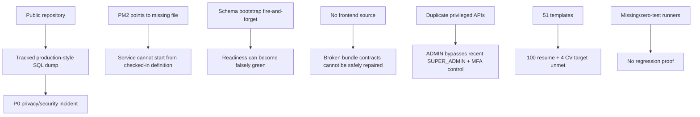

# Executive Summary

IME365 cannot be certified for production at the audited revision. The repository is public and contains a tracked production-style SQL data dump; the checked-in PM2 definition resolves to a nonexistent entry point; the cluster path never starts an HTTP listener; readiness can report success before schema bootstrap completes; the test command is missing and the “enterprise” test command discovers zero tests; compiled frontend artifacts cannot be rebuilt because their source and build system are absent; privileged user mutations have conflicting authorization controls; and several core product paths are defective or cannot meet the stated template requirement.

## Headline numbers

| Measure | Result |
|---|---:|
| Tracked files | 993 |
| Backend JavaScript files | 145 |
| Compiled public assets | 672 |
| HTTP route declarations | 459 |
| Database migrations | 33 |
| Tracked automated test files | 0 |
| Canonical issues | 32 |
| P0 / P1 / P2 / P3 | 1 / 17 / 14 / 0 |
| Current resume-template registrations | 51 |
| Required resume/CV registrations | 100 / 4 |
| Runtime dependency advisories | 16 (1 critical, 4 high, 10 moderate, 1 low) |

## Release-blocking chains

## What was actually verified

- Repository and Git history inspection pinned to `df5902d…`.
- All 646 tracked JavaScript files syntax-checked successfully in four bounded batches.
- Both tracked PHP files passed `php -l`.
- `npm test` failed because the configured runner is missing.
- `npm run test:enterprise` exited zero while discovering zero tests; it is classified **FAIL**, not pass.
- `npm audit --omit=dev` returned 16 runtime advisories.
- Isolated Node runtime probes verified health, readiness, CORS, Helmet, unauthenticated export rejection, and admin authentication rejection.
- Playwright inspected the public UI at 320, 375, 768, 1024, and 1440 px, plus template, blog, legal, enterprise/auth journeys.
- Four genuinely separate audit agents covered architecture/data, security/reliability, product/UI, and independent verification.

## What was not certified

Live MariaDB migrations, Firebase mutations, payments, SMTP, AI providers, authenticated editor flows, or PDF/DOCX visual parity were not exercised with production credentials. The repository has no reproducible frontend source build, so exact source patches for compiled-only defects are explicitly blocked until source provenance is restored.

## Immediate decisions

1. Execute the DATA-001 incident plan before routine engineering.
2. Freeze production promotion from this revision.
3. Restore reproducible frontend source and a nonzero test gate.
4. Correct startup, readiness, and privileged-control-plane defects.
5. Repair core persistence and template policy paths.
6. Run the staged qualification plan before reconsidering release.
