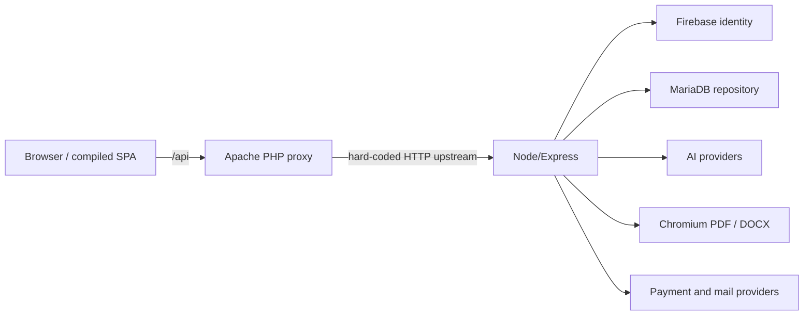

# Master Audit Report

## Scope and method

The audit combined recursive Git inventory, source and dependency analysis, line-pinned contract tracing, isolated runtime probes, five-viewport Playwright inspection, static asset reachability analysis, adversarial red-team passes, and independent solution challenge. The immutable Node/Express + compiled React-style SPA + MariaDB + Firebase identity + Chromium/DOCX export architecture was preserved.

The authoritative revision is `df5902dd897ff8e7955a738ac580f2a0d0263d0d`. Local user-owned untracked files (`dist/`, `start-ime365.bat`, and `stop-ime365.bat`) were not changed.

## Current architecture

The checked-in deployment contract is internally inconsistent: Apache proxies to a hard-coded cleartext public address, Node can bind all interfaces, PM2 points to a missing root entry, and the cluster entry never invokes the guarded listener. The data layer simultaneously retains MariaDB, Firestore, sync, fencing, and tombstone authorities even though runtime comments describe MariaDB as canonical.

## Principal findings

### Data and security

- [DATA-001](07-developer-fixes/security/DATA-001.md): public tracked SQL dump with personal and operational data.
- [SEC-001](07-developer-fixes/security/SEC-001.md): duplicate privileged APIs bypass recent-SUPER_ADMIN/MFA policy.
- [SEC-002](07-developer-fixes/security/SEC-002.md): reset tokens can become reusable after the password changes.
- [SEC-003](07-developer-fixes/security/SEC-003.md): stored remote image URL can drive export-side SSRF.
- [SEC-004](07-developer-fixes/security/SEC-004.md): cleartext proxy and incompatible trusted-client-IP assumptions.
- [SEC-005](07-developer-fixes/security/SEC-005.md): dependency security gate reports 16 advisories.

### Reliability and data integrity

- [OPS-001](07-developer-fixes/operations/OPS-001.md): PM2 entry point does not exist.
- [OPS-002](07-developer-fixes/operations/OPS-002.md): cluster workers require but never start the server.
- [DB-001](07-developer-fixes/database/DB-001.md): readiness ignores schema state and races bootstrap.
- [DB-002](07-developer-fixes/database/DB-002.md): failed baseline migration can return a pooled connection with foreign keys disabled.
- [API-001](07-developer-fixes/api/API-001.md): payment webhook replay reports processing without invoking the processor.
- [OPS-004](07-developer-fixes/operations/OPS-004.md): configured tests are missing or discover zero cases.

### Product

- [BUG-001](07-developer-fixes/functional/BUG-001.md): cover save/delete wrappers import an object that the chunk never exports.
- [BUG-002](07-developer-fixes/functional/BUG-002.md): AI-generated cover text is saved from stale state and save failures can strand UI state.
- [BUG-003](07-developer-fixes/functional/BUG-003.md): admin template disabled/PRO policy is not enforced by editor/export surfaces.
- [EXPORT-001](07-developer-fixes/exports/EXPORT-001.md): only 51 resume templates are registered; four cover-letter layouts are not four CV templates.
- [ARCH-001](07-developer-fixes/architecture/ARCH-001.md): frontend source, manifest, lockfile, source maps, and tests are absent.

### UI/accessibility

At 320 px the inner public-site surface measured 381 px inside a 290 px wrapper, causing clipped content. The page uses a fixed-height nested scroller, creates nested `main` landmarks, fails reduced-motion behavior, exposes undersized controls, and uses a keyboard-inaccessible preview `div`. The auth sheet has no dialog semantics, focus trap, Escape behavior, required/invalid associations, or semantic mode-switch control. Details and repairs are in [UI_UX_MASTER_AUDIT.md](03-ui-ux/UI_UX_MASTER_AUDIT.md).

## Cleanup

Static import reachability from the active HTML entry identified 379 reachable assets (approximately 27.4 MB) and 293 unreferenced assets (approximately 36.4 MB). Repeated hashed generations are candidates, not automatic deletions. The safe plan first restores source/build provenance, creates route and asset manifests, proves parity, and only then removes unreachable artifacts.

## Verdict

**NO-GO.** DATA-001 alone blocks release. Even after containment, startup, schema readiness, privileged authorization, reset-token state, export isolation, test execution, frontend provenance, cover persistence, template policy, and template completeness must pass their objective release gates.
